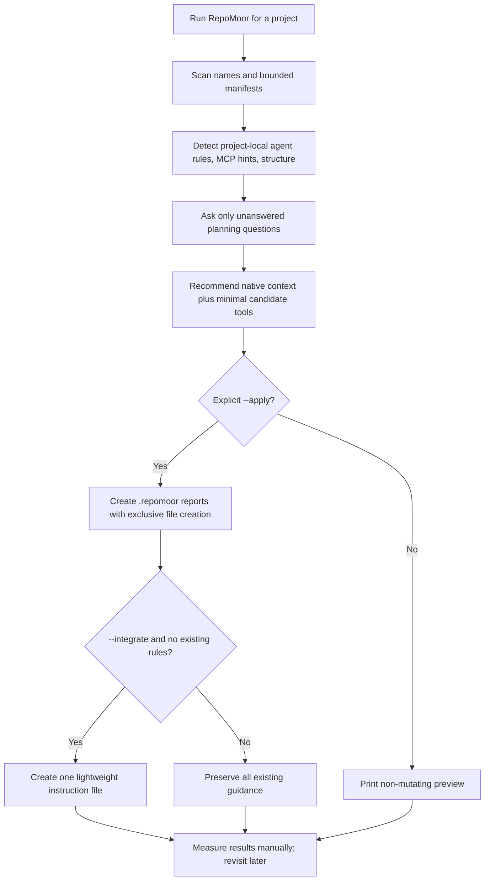

# RepoMoor ⚓

**Anchor your AI coding tools to the project, not your entire machine.**

[](https://github.com/karanzykx/repomoor/actions/workflows/ci.yml)
[](https://github.com/karanzykx/repomoor/releases/latest)

[](LICENSE)

RepoMoor is a **project-local, no-overwrite advisor** for AI-assisted development. It scans a blank or existing repository, asks a few numbered questions, identifies existing project configuration, and recommends a minimal AI coding setup. It does **not** automatically install third-party tools, modify global agent settings, or replace anyone's instructions.

> **Status: v0.1.0 preview.** Discovery, interactive or file-based answers, explained recommendations, a 19-tool catalog, project-local reports, conservative instruction opt-in and a read-only health check work today. Behaviour can still change between 0.x versions. It does not install tools, index code or measure token savings yet. See the [roadmap](docs/ROADMAP.md).

## Why this exists

AI agents waste context by re-reading large files, repeating repository searches, forgetting previous architectural decisions, collecting huge logs, and installing overlapping retrieval tools. The correct solution depends on the *particular repository*. A small CLI doesn't need the same tools as a 30-service monorepo.

**Reduce avoidable work, not just tokens.** RepoMoor optimizes for correct tasks completed per dollar/minute, not flashy percent savings on a single search result.

## Quick start: no installation

Requires Python 3.10 or newer. No packages, no API keys, nothing to install.

```bash
git clone https://github.com/karanzykx/repomoor.git
cd repomoor

# Preview only: scans, asks a few questions, changes nothing.
python3 repomoor.py /absolute/path/to/your-project

# Same CLI with a POSIX shell launcher:
./repomoor.sh /absolute/path/to/your-project

# Preview in JSON without any writes or interactive questions:
python3 repomoor.py /absolute/path/to/your-project --json

# Create new, project-local report files only (never replace existing):
python3 repomoor.py /absolute/path/to/your-project --apply

# OPTIONAL: also create AGENTS.md or CLAUDE.md if *no* agent rules exist:
python3 repomoor.py /absolute/path/to/your-project --apply --integrate

# Inspect the project's local configuration and report staleness, read-only:
python3 repomoor.py /absolute/path/to/your-project --doctor

# See all 19 investigated tool candidates (does not scan a repository):
python3 repomoor.py --catalog
```

In an interactive terminal, RepoMoor asks about coding agents, the priority (cost/correctness/speed), likely bottleneck and, only when needed, the planned architecture. With `--json`, `--non-interactive`, or redirected stdin it uses conservative defaults. For reproducible runs (CI, benchmarks), pass `--answers answers.json`; see [`examples/answers.example.json`](examples/answers.example.json) and the [operator guide](docs/OPERATOR_GUIDE.md#answers-file).

### Optional Python package install

For a convenient `repomoor` command, install the cloned source into a virtual environment:

```bash
python3 -m venv .venv
. .venv/bin/activate
python -m pip install -e .
repomoor /absolute/path/to/your-project --doctor
```

**Note:** the optional `pip install` step changes the active Python environment, not the project you analyze. If your goal is strictly no additional environment changes, use `python3 repomoor.py` instead. RepoMoor itself never runs pip or external installers.

### Example

Run against the bundled sample monorepo (`python3 repomoor.py examples/sample-monorepo --answers examples/answers.example.json`):

```text
Architecture: potentially-complex (signal:workspace_detected=pnpm-workspace.yaml,package.json workspaces)

Foundation / pilots:
  + Native project context + curated architecture decisions [NATIVE_CONTEXT_BASELINE]
     No third-party dependency; useful for any repo size. Preserve any existing agent instructions.
     evidence: policy:always
  + code-review-graph (optional pilot, not auto-install) [GRAPH_PILOT_IMPACT]
     Large/multi-service repositories with impact-analysis needs warrant a controlled graph trial.
     evidence: signal:workspace_detected=pnpm-workspace.yaml,package.json workspaces; answer:pain=impact

Optional:
  ? Trail-Code [GRAPH_ALT_DISCOVERY]: Alternative if recurring architectural decisions are a bigger waste than dependency tracing.

Intentionally skipped:
  - [OUTPUT_SKIP_UNMEASURED] Do not add RTK/Headroom until logs/tool outputs are measured as a real bottleneck.
```

Every line says what was recommended, why, and which file or answer triggered it.

## The workflow



### What is created by `--apply`

```text
your-project/
└── .repomoor/
    ├── project-profile.json    # Scan signals + selected answers + proposed stack
    ├── PROJECT_CONTEXT.md     # Inferred map and careful retrieval guidelines
    └── recommendations.md     # Why tools were selected or deferred
```

`--integrate` additionally creates **only one** small root instruction file if no existing rules were found: `AGENTS.md` for Cursor/both/other, or `CLAUDE.md` for Claude-only. It skips integration when the project already has guidance (including scoped rules), never appends or merges, and never changes `.mcp.json`, `.cursor/mcp.json`, or agent hooks.

Generated reports are deliberately **create-only**. On rerun, unchanged files are left untouched; changed reports are left intact, with a notice. To refresh, first review/archive or delete the previously generated files yourself and rerun. `--doctor` warns if a saved profile appears stale.

## Supported detection (heuristic, not an AST parser)

- Files and source-language counts for TypeScript/JavaScript, Python, Go, Rust, Java, Kotlin, C#, Ruby, PHP, Swift, Dart, C/C++, Vue, Svelte, Elixir.
- Package and build markers such as `package.json`, `pyproject.toml`, `Cargo.toml`, `go.mod`, Java manifests, workspace manifests, Docker Compose and Dockerfiles.
- Monorepo/workspace hints; multiple service/package hints; some frontend dependency signals.
- Project-local `AGENTS.md`, `CLAUDE.md`, `.claude/rules`, `.cursor/rules`, `.mcp.json`, `.cursor/mcp.json`, and selected known tool markers.
- Bounded directory walk (default 12,000 files / 6 levels), excluded dependency/build directories, symlink avoidance, profile staleness.

**It does not know:** which global tools are installed, whether a referenced MCP server actually runs, whether an index is current, dynamic runtime call graphs, whether code is correct, actual API pricing, or whether any tool saves tokens on your tasks.

## Choosing tools

RepoMoor defaults to short native guidance and meaningful code documentation. It recommends a **single** graph candidate when a complex repository and task justify it, then optional specialists such as RTK for shell-output-heavy work or agent-browser for UI automation.

The [19-tool research catalog](docs/TOOL_CATALOG.md) includes Graphify, GitNexus, codebase-memory-mcp, code-review-graph, Trail-Code, token-savior, jcodemunch-mcp, toktoken, tokensave, codemap, sprout, RepoMapper, repomix, aider, RTK, Headroom, agent-browser, claude-mem, and caveman. The catalog is for research, **not** a guarantee of availability, license suitability, security, or performance.

## Security boundaries

| Operation | Default behavior |
|---|---|
| Preview / catalog / doctor | Read-only; no installations |
| Inspect `~/.claude`, system applications, user settings | **Never** |
| Run package scripts, hooks, installers, MCP services | **Never** |
| Follow project symlinks | **Never** during traversal/writes |
| Reveal values in MCP settings/environment | **Never intentionally**; reports carry detected tool names only |
| Replace, append, or merge pre-existing files | **Never** |
| Write to an explicit target repo | Only with `--apply`, create-only |
| Author new agent instructions | Only with `--apply --integrate` and no existing rules |

See [security model](docs/SAFETY.md) for known limitations and the [privacy note](docs/OPERATOR_GUIDE.md#private-repository-considerations) before committing generated project profiles.

## Run tests

```bash
python3 -m unittest discover -s tests -v
```

65 offline regression tests (including golden-output tests for every command mode) cover blank repos, monorepos, secrets staying out of output, manifests not being executed, preserving prior rules, refusing symlinked output, non-mutating preview, idempotence, doctor behavior, strict `--answers` validation, reason codes and evidence for every decision, module boundaries, symlink-swap races in the writer, hostile or oversized manifests and huge directory trees, nested agent rules blocking integration, and the complete catalog. CI runs the same suite.

## Documentation

| Read | Purpose |
|---|---|
| [Architecture](docs/ARCHITECTURE.md) | Modules, data flow, boundary design |
| [FAQ](docs/FAQ.md) | Setup, scope, safety, and token-saving questions |
| [Product specification](docs/PRODUCT_SPEC.md) | Users, flows, acceptance criteria |
| [Safety model](docs/SAFETY.md) | Threats and non-negotiable invariants |
| [Catalog](docs/TOOL_CATALOG.md) | All 19 candidates and overlap categories |
| [Adapter proposal](docs/ADAPTER_SPEC.md) | Planned safe integration framework, not yet implemented |
| [Benchmark methodology](docs/BENCHMARKS.md) | How to prove improvements end-to-end |
| [Roadmap](docs/ROADMAP.md) | Milestones, priorities and exit criteria |
| [Decision records](docs/adr/) | Why the major design choices were made |

## Continuous integration

A GitHub Actions workflow in `.github/workflows/ci.yml` runs the offline tests on Linux, macOS and Windows with Python 3.10 to 3.13.

## Contributing and license

See [CONTRIBUTING.md](CONTRIBUTING.md), [SECURITY.md](SECURITY.md), and [LICENSE](LICENSE) (MIT). RepoMoor is not affiliated with Anthropic, Cursor, or any project in its catalog. Other projects keep their own licenses.
