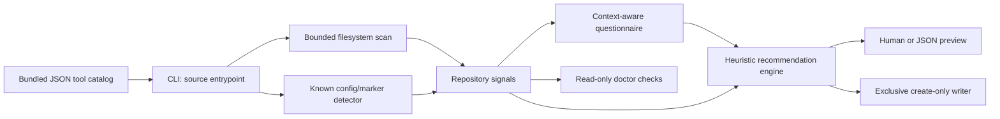
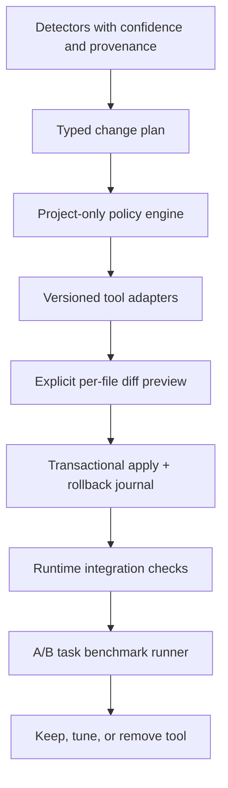

# Architecture

## Goals

1. Run on blank, small, polyglot, and multi-service repositories.
2. Do useful discovery without requiring paid AI APIs or background services.
3. Prevent accidental changes to existing project and personal agent configuration.
4. Recommend *complementary*, not redundant, tools.
5. Preserve enough facts and decision history to revisit recommendations after a project evolves.

## Implemented architecture (v0.1.0)

### Modules (since the v0.3 split)

| Module | Owns | May import (RepoMoor) |
|---|---|---|
| `constants.py` | `VERSION`, `OUTPUT_DIR` | none |
| `fs.py` | Bounded project-contained reads and `safe_create`, the **only** file writer | none |
| `parsing.py` | Bounded JSON parsing that returns an issue code instead of raising | none |
| `scanner.py` | `enumerate_repo`, `project_signals`, known paths/keywords | `constants`, `fs`, `parsing` |
| `questions.py` | `QUESTIONS`, prompts, strict `--answers` loader | `parsing` |
| `recommender.py` | `REASON_CODES`, `make_recommendations`; pure, no I/O | none |
| `report.py` | Profile JSON, `PROJECT_CONTEXT.md`, `recommendations.md`, optional rule-file contents | `constants`, `fs` |
| `doctor.py` | Read-only `--doctor` checks | `constants`, `fs`, `parsing` |
| `catalog.py` | Bundled tool catalog loader | none |
| `cli.py` | Argument parsing and wiring; re-exports the v0.2 names (`cli.enumerate_repo`, …) | all of the above |

`ModuleBoundaryTests` enforces this table. It also keeps imports to an explicit standard-library allowlist (no `subprocess`, `socket`, `urllib`, `shutil`), keeps `recommender.py` free of I/O, and fails if any module other than `fs.py` writes, renames or deletes files. `src/repomoor/data/tools.json` is **informational**; recommendation rules live in `recommender.py`, not in a dynamic plugin engine. `repomoor.py` bootstraps imports without package installation; `repomoor.sh` is a POSIX wrapper; `pyproject.toml` exposes `repomoor` as an optional console entry point.

## Data shapes

- **Scan:** `source_counts`, `sampled_source_files`, `files_examined`, `dirs_examined`, `scan_truncated`, `symlinks_skipped`, `manifests`, `component_roots`.
- **Signals:** detected project-local agent paths, known graph/output names in *bounded local* configs, workspace and frontend hints, blank/uninitialized flag.
- **Answers:** agents, optimization priority, expected bottleneck, intended project, possible service scope.
- **Recommendation:** complexity label with `complexity_evidence`, foundation and optional pilots, intentionally skipped choices (`deliberately_skipped` as plain strings for v0.2 consumers, `skipped_details` with codes), recommended measurements. Every recommended, optional and skipped entry has `code` and `evidence`.
- **Artifacts:** `project-profile.json`, `PROJECT_CONTEXT.md`, `recommendations.md`, optionally a new root instruction file.
- **Doctor:** machine-readable health checks with `ok`/`info`/`warn` severity and warning count.

## Scan rules and trust boundaries

- Only explicitly supplied project root is traversed. The root itself is normalized (a user-supplied root symlink resolves to its target; this is disclosed in JSON via `root`). Children that are symlinks are skipped.
- Directory names in an exclusion list are not scanned, including `.git`, `node_modules`, `.venv`, `dist`, `build`, and `.repomoor`.
- Files are counted by extension; content is read only from a small allowlist of local manifest/config paths, and with size caps.
- Reading a manifest is *not* executing package scripts, tools, or build processes.
- Config raw content and secret values are not included in reports; only detected names/markers are retained.
- The tool does not inspect user/home environment for installed global tools: it intentionally cannot certify a globally installed tool.
- File creation uses exclusive file creation and checks symlinked parents; existing files are never replaced. This protects common local workflows, but it is **not** a security sandbox against an actively malicious process concurrently modifying filesystem paths. See SAFETY.md.

## Recommendation logic (current, intentionally modest)

- Native project instructions and documented decisions are recommended for every project.
- No extra graph for an empty repo.
- If a known project graph is already referenced, recommend verifying it before adding overlapping graphs.
- Complex projects needing repeated exploration may pilot Trail-Code; dependency/impact concerns may pilot code-review-graph.
- Smaller projects with explicit navigation pain may pilot Sprout or codemap.
- Terminal-heavy workflows may consider RTK; browser-heavy workflows may consider agent-browser.
- Defer automatic memory/graph/compression stacks without a measured failure mode.

These are hypotheses. They are *not* predictions from a trained classifier, and not guarantees of cost savings.

### Reason codes and evidence

Every decision in the plan carries a stable `code` and an `evidence` list. Codes are part of the JSON contract: a code is never renamed or reused; changed logic gets a new code. The source of truth is `REASON_CODES` in `src/repomoor/recommender.py`, and a regression test fails if any code is unregistered, appears under the wrong outcome, or can no longer be reached.

| Code | Outcome | Meaning |
|---|---|---|
| `NATIVE_CONTEXT_BASELINE` | recommended | Native rules and docs are the zero-dependency baseline for every repository. |
| `GRAPH_REUSE_EXISTING` | recommended | A project-local graph/index integration is already configured; reuse it. |
| `GRAPH_SKIP_DUPLICATE` | skipped | A graph is already configured; a second overlapping graph is not added. |
| `GRAPH_SKIP_BLANK` | skipped | The repository has no code yet, so there is nothing to index. |
| `GRAPH_PILOT_DISCOVERY` | recommended | Complex repository with repeated-discovery or unknown pain: pilot a mapping/decision tool. |
| `GRAPH_PILOT_IMPACT` | recommended | Complex repository where change impact or correctness matters most: pilot an impact graph. |
| `GRAPH_ALT_IMPACT` | optional | Impact-focused graph offered as an alternative to the discovery pilot, not an addition. |
| `GRAPH_ALT_DISCOVERY` | optional | Discovery-focused tool offered as an alternative to the impact pilot, not an addition. |
| `GRAPH_BENCHMARK_LATER` | optional | Complex repository but no stated discovery bottleneck: benchmark a graph later. |
| `MAP_LIGHTWEIGHT` | optional | Mid-sized repository with discovery/impact pain: try a light map before an MCP graph. |
| `GRAPH_SKIP_SCALE` | skipped | Native search is a reasonable baseline at this scale and workload. |
| `OUTPUT_SKIP_DUPLICATE` | skipped | Output compression is already configured in the project; do not duplicate it. |
| `OUTPUT_PILOT_TERMINAL` | optional | Large terminal output was named as the main waste: pilot output compression. |
| `OUTPUT_SKIP_UNMEASURED` | skipped | Output compression waits until tool output is measured as a bottleneck. |
| `BROWSER_PILOT` | optional | Browser work was named, or a web project is planned or prioritised for speed. |
| `REASSESS_AFTER_CODE` | optional | Blank repository: rerun once real code and topology exist. |

Evidence entries are short strings with a prefix that says where they come from:

- `signal:` marks a scan signal, e.g. `signal:workspace_detected=pnpm-workspace.yaml` or `signal:configured_graph_tools=trail`. Only file names and fixed keyword names appear; config values are never copied.
- `answer:` marks a questionnaire answer, e.g. `answer:pain=impact`. The report's `answer_sources` says where that answer came from.
- `scan:` marks a count threshold, e.g. `scan:sampled_source_files=412>=350`.
- `policy:always`: the baseline that applies to every repository.

`plan.complexity_evidence` lists every condition that made the repository count as complex; it is empty exactly when the assessment is `small-or-early-stage`.

## Future architecture (proposal, not implemented)

The policy engine should enforce a restricted filesystem allowlist and check a tool's actual install commands rather than trusting flags like `--local`. A tool that cannot demonstrably confine its effects to the project should remain recommendation-only.

## Performance and limits

- Max files, depth and directories are configurable (`--max-files`, `--max-depth`, `--max-dirs`). Each directory listing is capped at 20,000 entries, so one enormous folder cannot exhaust memory. `scan.truncation_reasons` lists every limit that was hit (`max_files`, `max_dirs`, `max_dir_entries`); `scan.dirs_unreadable` counts directories that could not be listed.
- Untrusted JSON goes through `parsing.parse_json`, which refuses nesting deeper than 64 levels before calling `json.loads`. Files that are too large, not regular files, unreadable or unparsable are listed in `signals.parse_issues` as `{path, code}`.
- Monorepo detection is heuristic; symbolic links are not followed; unrecognized languages/frameworks can be missed.
- This is not an AST engine, indexer, or continuous daemon.
- Current profile freshness only compares sampled language counts and known manifest paths; semantic source changes can occur without a warning.

## Evolution principles

Keep detector evidence separate from heuristics, keep decisions deterministic and explainable, and make the minimal safety policy testable independently of all third-party integrations. Resist adding an LLM call just to discover what filesystem metadata can reliably tell us.
